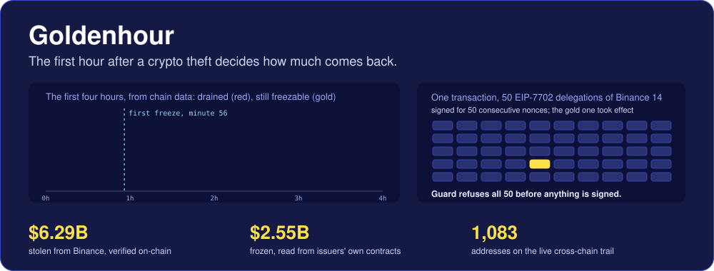
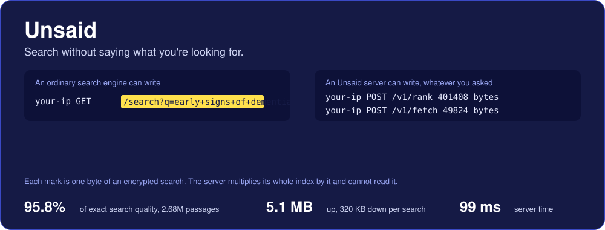

<p align="center"></p>

<p align="center">
  <a href="https://www.linkedin.com/in/dharmeshmeena/"></a>
  
  <a href="https://dharmeshdev1.github.io/goldenhour/"></a>
  <a href="https://dharmeshdev1.github.io/mercalli/"></a>
  <a href="https://dharmeshdev1.github.io/unsaid/"></a>
</p>

```console
dharmesh@ml:~$ cat focus.txt
stolen money followed hop by hop, from chain data
forecasts whose ranges hold their stated coverage
retrieval that is measured, not guessed
agents whose failures are tested code paths
evaluation numbers that come with confidence intervals

dharmesh@ml:~$ ls projects/
goldenhour/   mercalli/   unsaid/   microllm/   nanoserve/   agenteval/   rag-eval-lab/   agentkit/   evalkit/

dharmesh@ml:~$ _
```

<p align="center"></p>

## Newest

<a href="https://github.com/dharmeshdev1/goldenhour"></a>

**[Goldenhour](https://github.com/dharmeshdev1/goldenhour)** is crypto theft response, from the signer to the last hop, built on the largest theft on record: about $6.4 billion taken from Binance on 29 October 2026. It refuses the malicious signature, detects a drain while it happens, measures the freeze window minute by minute, follows the stolen money across chains every five minutes, and lets exchanges screen deposits without revealing what they screen: **[see it live](https://dharmeshdev1.github.io/goldenhour/)**.

- The Guard decodes what a signing request would actually do. Replayed on the real attack transaction, which carried 50 EIP-7702 authorizations signed by one Binance custody key for 50 consecutive nonces, it refuses all 50 and records each decision in a signed, hash-chained audit log.
- The trace reads Ethereum, Bitcoin, Tron, the XRP Ledger and Solana directly, plus the THORChain and Relay swaps between them. As of 9 November it verifies $6.29 billion of the reported $6.43 billion on-chain, finds $2.55 billion frozen by Tether and Circle, and $2.99 billion still held at 921 addresses, every number tied to its transactions.
- A review before launch found 25 real problems, among them screening that leaked up to six hash prefixes per lookup and a Solana parser that missed wrapped SOL. All are fixed with regression tests, and the pipeline refuses to deploy a site that is broken or suddenly smaller.

<p align="center"></p>

## Flagships

<a href="https://github.com/dharmeshdev1/mercalli"></a>

**[Mercalli](https://github.com/dharmeshdev1/mercalli)** is outage intelligence for the services you depend on. It watches about 900 public status pages (clouds, CDNs, developer tools, AI APIs, payments), forecasts how long each open incident will last with a calibrated range, predicts which other services an outage at a cloud or CDN will hit, and maps which DNS, edge network and cloud region the top 10,000 sites rely on: **[see it live](https://dharmeshdev1.github.io/mercalli/)**.

- It runs itself: GitHub Actions polls every page about every five minutes and deploys the site, refreshes the incident history daily, and retrains, evaluates and signs the models every week. A self-hosted edition adds PostgreSQL, a live event stream and alerts to Slack, Teams, PagerDuty and webhooks, with Docker Compose and a Helm chart.
- Tested on 11,390 incidents from 2026 held out from training, the forecaster beats the best simple rule (mean log error 1.26 against 1.35), and its 80% ranges contained the real outcome **80.4%** of the time, thanks to conformal calibration. The gain in point accuracy is modest, and the README says so.
- A review before launch found 12 real problems, including a label leak that inflated one model's score and a path traversal through vendor incident ids. All twelve are fixed, and the leak and what it did to the numbers are written up in the methodology.

<a href="https://github.com/dharmeshdev1/unsaid"></a>

**[Unsaid](https://github.com/dharmeshdev1/unsaid)** is a search engine that cannot read your queries. The question is encrypted on your device with lattice cryptography (learning with errors), and the server ranks documents and returns them without learning the question or the results. It is one 4.5 MB Rust binary, and the same client runs in a browser through WebAssembly: **[try it live](https://dharmeshdev1.github.io/unsaid/)**.

- Retrieves **95.8% of exact search quality** over 2.68 million passages (BEIR NQ), measured through the real protocol with real encryption, at 5.1 MB up, 320 KB down and 99 ms of server time per search.
- Built from scratch: the encryption, a BERT encoder in safe Rust, balanced clustering, the server, an MCP tool for AI agents, and a Python tutorial client that interoperates with the Rust server from the protocol document alone.
- Two adversarial reviews found real flaws (a crafted model file could reveal words in a query through a crash). They are fixed with regression tests, and the security notes say plainly that it has not had an independent audit.

**[microllm](https://github.com/dharmeshdev1/microllm)** is a from-scratch LLM stack: byte-level BPE tokenizer, a decoder-only transformer (RoPE, grouped-query attention, SwiGLU, KV cache), a resumable training loop, and speculative decoding that provably samples from the target distribution.

- Trained a 24.6M parameter model on TinyStories to 0.779 bits per byte on held-out stories, with a 2.5M draft model for speculative decoding (1.04x to 1.26x measured speedup).
- 139 tests, including attention checked against a naive reference, a chi-square test that speculative samples match the target distribution, and bit-exact checkpoint resume.
- The README reports its limitations and the results that did not flatter it.

**[nanoserve](https://github.com/dharmeshdev1/nanoserve)** is an LLM inference engine that serves microllm models: a paged KV cache, continuous batching with preemption, and an HTTP server.

- Measured 2.0x to 4.4x higher throughput than serving requests one at a time, with median time to first token down from 4.0 s to 0.09 s, on a real trained model.
- Its defining property is tested: a request's output is identical to running it alone, whatever else is in the batch and however often it is preempted.
- Its own tests found real bugs in the server (a connection backlog reset, keep-alive corruption, a crash on malformed input), all fixed and documented.

**[agenteval](https://github.com/dharmeshdev1/agenteval)** is a harness for evaluating AI agents on real tasks, built so that its scores can be trusted: agents work in a kernel-enforced sandbox and a hidden verifier they cannot read judges the result.

- 12 real tasks (git, SQL, shell, build systems, refactoring, performance), each validated by the harness itself: a do-nothing agent fails, the reference solution passes, and 37 plausible wrong solutions are all rejected.
- Defends against cheating and tests each defence with an actual attack: reading or editing the verifier, symlink escapes, planted files, standard library shadowing, editing protected tests, network access.
- That validation found four weak verifiers in my own tasks before release, and CI found a gitignore bug that hid a task file. Both are fixed and written up in the README.

<p align="center"></p>

## More projects

Each has no runtime dependencies, a test suite, lint and CI on Python 3.10 to 3.13, and a README that states its limitations.

| Project | What it is | Highlights |
| --- | --- | --- |
| [**rag-eval-lab**](https://github.com/dharmeshdev1/rag-eval-lab) | Retrieval library and evaluation harness | BM25, hashed n-gram vectors, reciprocal rank fusion, recall@k, MRR, nDCG |
| [**agentkit**](https://github.com/dharmeshdev1/agentkit) | Tool-using agent loop | Typed tool schemas, error recovery, repeat and step guards, JSONL traces, AST-based calculator |
| [**evalkit**](https://github.com/dharmeshdev1/evalkit) | Evaluation statistics toolkit | Unbiased pass@k, seeded bootstrap CIs, paired bootstrap, exact sign test, graders |

## How I work

- **Measure first.** A change is only an improvement if a metric moved, and the metric reports its uncertainty.
- **Make failure modes explicit.** Malformed tool calls, loops and missing data are handled paths with tests, not surprises.
- **Say what the numbers do not show.** Every README lists its limitations next to its results.

## Stack


Topics I work on: reliability engineering and calibrated forecasting, private retrieval and applied cryptography, language model internals and inference serving, agent evaluation and sandboxing, retrieval and ranking, LLM evaluation, experiment statistics.

## Contact

Message me on [LinkedIn](https://www.linkedin.com/in/dharmeshmeena/).

<p align="center"></p>
